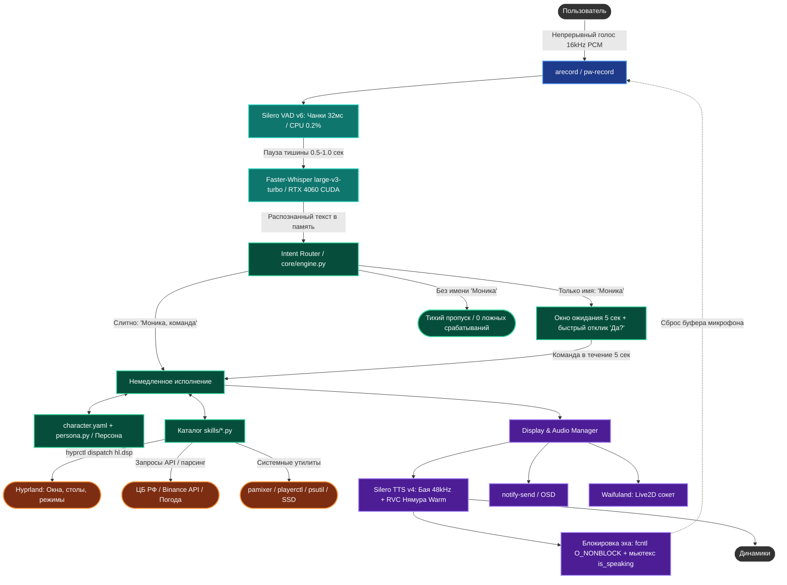

# AGENTS.MD: База знаний и руководство разработчика голосового ассистента «Моника» (ZeroVoiceAgent)

> **Статус проекта**: Полностью рабочий локальный ассистент с бесшовным голосовым управлением  
> **Окружение**: Linux (Arch Linux / Omarchy), Wayland, Hyprland (Lua engine), GPU NVIDIA GeForce RTX 4060  
> **Ключевой стек**: Python 3.14, Silero VAD v6, Faster-Whisper (CUDA), Vosk (KWS), Silero TTS v4 + RVC, Hyprland IPC (Lua), pamixer, playerctl, notify-send  
> **Философия**: 100% детерминированность, мгновенный отклик (<40–50 мс для макросов, ~180 мс для STT, ~90–120 мс для TTS), нулевая стоимость вызовов, полное отсутствие облачных зависимостей, токенов и лимитов на запросы.

---

## 1. Концепция и ключевые цели проекта

**ZeroVoiceAgent («Моника»)** — модульный, полностью локальный и приватный голосовой ассистент для глубокой интеграции с операционной системой и рабочим окружением **Hyprland** в дистрибутиве **Omarchy**.

В отличие от тяжеловесных фреймворков (Hermes Agent, AutoGen и др.) и облачных языковых моделей (Mistral, OpenAI, Groq), архитектура проекта:
1. **Исключает «бутылочные горлышки»**: нет лимитов на количество запросов в секунду (как 1 RPS у бесплатного API Mistral), лимитов токенов и задержек сетевого трафика.
2. **Обеспечивает сверхнизкую задержку**:
   - Выполнение системных команд, открытие окон и запуск макросов занимает **10–40 миллисекунд**.
   - Распознавание речи на GPU (Faster-Whisper `large-v3-turbo` на RTX 4060) занимает **~150–200 миллисекунд**.
   - Локальный синтез ответа (Silero TTS v4) занимает **~80–120 миллисекунд** (а частые фразы воспроизводятся из WAV-кэша за **0 миллисекунд**).
3. **Исключает ошибки вызова инструментов (Tool Calling)**: локальные 7B/8B модели часто ломают синтаксис JSON или выводят вызовы функций обычным текстом. Детерминированный роутер на Python (`core/engine.py`) гарантирует 100% стабильность и предсказуемость выполнения.
4. **Учитывает архитектуру Omarchy**: Hyprland в Omarchy управляется через встроенный Lua-движок (`hl.dsp.*`), поэтому вызовы команд адаптированы под нативный Lua-синтаксис.
5. **Легко расширяется**: добавление новых действий, сложных макросов и интеграций осуществляется через простые функции на Python с декоратором `@skill` и декларативные конфигурации.
6. **Поддерживает естественную речь (One-Shot + Окно ожидания)**: не требует ждать ответа после имени. Поддерживает как слитное произношение (*«Моника, сколько времени»*), так и с паузой для размышления (*«Моника»* ➔ ответ *«Да?»* ➔ *«закрой окно»* в течение 5 секунд).

---

## 2. Системные требования и аппаратное окружение

### 2.1. Основной рабочий профиль (Workstation / Desktop с GPU)
* **Операционная система**: Linux (Arch Linux / дистрибутив Omarchy, ядро 6.x+).
* **Графический сервер и WM**: Wayland, Hyprland (с нативным движком скриптинга на Lua).
* **Видеокарта (GPU)**: NVIDIA GeForce RTX 4060 (8+ ГБ VRAM, Compute Capability 7.0+).
* **Драйверы и CUDA**: NVIDIA Proprietary Driver, CUDA Toolkit 12.x, cuBLAS 12 (`libcublas.so.12`, `libcublasLt.so.12`).
* **Процессор (CPU)**: x86_64, 4+ ядра (для работы Silero VAD и Silero TTS TorchScript).
* **Оперативная память (RAM)**: от 8 ГБ (ассистент в фоновом режиме потребляет ~400–800 МБ).
* **Аудиоподсистема**: PipeWire + WirePlumber + ALSA (`arecord`, `pw-record`, `pamixer`). Формат потока: 16 кГц, 16-bit Mono PCM (микрофон) и 48 кГц Stereo (вывод).

### 2.2. Экономичный профиль (Ноутбук / Слабый ПК без дискретной GPU)
Проект спроектирован с возможностью работы исключительно на процессоре (скрипт автонастройки: `scripts/setup_laptop.sh`):
* **STT (Распознавание)**: `faster-whisper` модель `small` или `base`, `device: "cpu"`, `compute_type: "int8"`.
* **TTS (Синтез)**: Чистый `Silero TTS v4` (`active_preset: "baya"`), `device: "cpu"` (синтез за 90 мс на CPU, 0% VRAM, экономия 10 ГБ весов CUDA).
* **Потребление**: ~400 МБ RAM, минимальная нагрузка на батарею.

---

## 3. Системные инструменты, утилиты и окружения Python

### 3.1. Системные пакеты (Arch Linux / pacman)
```bash
sudo pacman -S --needed --noconfirm \
  iptables curl python python-pip python-pipx \
  pamixer wireplumber pipewire alacritty foot \
  playerctl libnotify hyprlock
```

### 3.2. Системные службы и внешние компоненты
* **`hyprctl`**: Утилита IPC-управления окнами Hyprland (команды `hl.dsp.*`).
* **`pamixer` / `wpctl`**: Управление громкостью основного аудиоустройства.
* **`playerctl`**: Управление медиаплеерами (Яндекс.Музыка, браузер, Spotify) по шине D-Bus MPRIS.
* **`notify-send` / `mako`**: Экранные всплывающие уведомления (OSD).
* **`zapret-discord-youtube-linux` (`nfqws`)**: Локальный сервис обхода замедлений YouTube/Discord по пути `~/zapret-discord-youtube-linux/service.sh`.
* **`ag-unlocker` (`ag_proxy`)**: Локальный прокси и watchdog для Antigravity IDE (`ag-unlocker-proxy.service`).
* **`Waifuland`**: Live2D прозрачный плавающий оверлей аватара, взаимодействующий через Unix domain socket `/tmp/waifuland.sock`.

### 3.3. Архитектура изолированных окружений Python (Multi-Venv)
Для предотвращения конфликтов версий PyTorch, CUDA и CTranslate2 в проекте используется разделение на изолированные окружения:

| Окружение | Путь | Назначение | Ключевые библиотеки |
|---|---|---|---|
| **Системный Python 3.14** | `/usr/bin/python3` | Оркестратор `main.py`, захват микрофона, Silero VAD v6, Faster-Whisper, роутер, скиллы | `faster-whisper`, `vosk`, `sounddevice`, `pyyaml`, `num2words`, `requests`, `numpy`, `av` |
| **Silero TTS Venv** | `~/.local/share/my_custom_agent/silero_venv` | Изолированный быстрый воркер CPU TorchScript для синтеза речи | `torch` (CPU), `torchaudio`, `sounddevice` |
| **RVC Venv** | `~/.local/share/my_custom_agent/rvc_venv` | Изолированный CUDA воркер для инференса модели голоса Нямуры (RMVPE) | `torch` (CUDA), `faiss-cpu`, `librosa`, `fairseq` |

---

## 4. Общая архитектурная схема и потоки данных



### Пять изолированных уровней ответственности:
1. **«Уши» (Слух)**: Непрерывный мониторинг звука через нейросетевой `Silero VAD v6` (<0.2% CPU) + мгновенное распознавание русской речи на GPU через `faster-whisper` (`large-v3-turbo` на RTX 4060, ~180 мс).
2. **«Мозг» (Диспетчер / Роутер)**: Фильтрация шума, определение формы обращения, поддержание 5-секундного окна ожидания, матчинг триггеров по длине и передача аргументов в зарегистрированные скиллы.
3. **«Характер» (Персона)**: Вежливый, лаконичный тон, учет обращения по имени пользователя (Армен по умолчанию), вариации реплик из `character.yaml`.
4. **«Руки» (Действия)**: Нативное взаимодействие с Hyprland через Lua API (`hl.dsp.*`), управление медиа (`pamixer`, `playerctl`), парсинг курсов ЦБ РФ и криптовалют Binance.
5. **«Рот и Лицо» (Вывод)**: Локальный синтез речи (`Silero TTS v4` + гибрид RVC Нямура 48 кГц со встроенной нормализацией чисел через `num2words` и авто-ударениями), всплывающие системные уведомления (`notify-send`) и Live2D-аватар (`Waifuland`).

---

## 5. Структура каталогов и файлов проекта

Проект развернут по пути: `/home/armen/my_custom_agent` (симлинк: `/home/armen/My Custom Agent`).

```text
my_custom_agent/
├── agents.md                # Этот файл: Полная база знаний, требования, инструменты и архитектура
├── README.md                # Общая документация и быстрый старт
├── CHECKLIST.md             # Чек-лист голосового тестирования всех сценариев
├── config.yaml              # Конфигурация VAD, Whisper, Silero TTS, RVC, путей и устройств
├── character.yaml           # Личность: реплики пробуждения, успеха, ошибок, имя пользователя, эмоции
├── main.py                  # Главная точка входа: One-Shot стриминг, CLI флаги, интерактивный режим
├── core/
│   ├── constants.py         # Единое хранилище системных констант, таймаутов и путей
│   ├── engine.py            # Маршрутизатор намерений (Intent Router), декоратор @skill, автозагрузка
│   ├── ears.py              # Захват аудио (arecord), Silero VAD v6, CUDA-автопатч, сброс эха
│   ├── mouth.py             # Синтез речи (Silero TTS v4 + RVC клиент), кэш аудио, мьютекс is_speaking
│   ├── silero_worker.py     # Фоновый воркер Silero TTS (CPU TorchScript)
│   ├── rvc_worker.py        # Фоновый воркер RVC (CUDA GPU инференс модели Нямуры)
│   ├── persona.py           # Менеджер характера (рандомизация реплик из character.yaml)
│   ├── display.py           # Консольный цветной вывод, notify-send, сокет Waifuland
│   └── wake.py              # Двухэтапный KWS детектор (Vosk / Sherpa) для fallback-режима
├── skills/                  # Каталог плагинов (автоматически сканируется и загружается)
│   ├── app_manager.py       # Запуск/закрытие программ (.desktop сканер + база алиасов)
│   ├── dictation.py         # Голосовая диктовка текста в активное окно Hyprland
│   ├── hyprland_control.py  # Управление окнами (Lua hl.dsp.*: закрыть, fullscreen, float, столы)
│   ├── media_control.py     # Громкость pamixer и управление плеерами по D-Bus (MPRIS)
│   ├── name_call.py         # Управление обращением к пользователю («называй меня Алекс/Армен»)
│   ├── system_info.py       # Время, дата, реальное ОЗУ (MemAvailable) и свободное место на SSD
│   ├── system_lock.py       # Блокировка экрана Hyprlock и запуск скринсейвера
│   ├── web_scraper.py       # Курсы валют ЦБ РФ (в рублях и копейках) и крипта (Binance API)
│   └── workspace_modes.py   # Смарт-режимы рабочих пространств (разработка, учёба, закрытие)
├── models/
│   └── rvc/nyamura/         # Веса RVC модели Нямуры (.pth и .index)
├── scripts/
│   ├── create_backup.sh     # Создание полного архива системы для миграции
│   └── setup_laptop.sh      # Скрипт автоматического развертывания на ноутбуке (CPU-only)
├── systemd/
│   ├── zerovoice.service    # Unit-файл systemd для запуска ассистента в фоне
│   └── my_custom_agent.service
├── test_pronunciation.py    # Скрипт калибровки микрофона, Vosk и Whisper
└── train_monika_voice.py    # Утилита обучения/адаптации голосовой модели Моники
```

---

## 6. Конфигурационные файлы (Детали и параметры)

### 6.1. Основной конфигурационный файл (`config.yaml`)
```yaml
system:
  name: "Моника"
  wake_word: "моника"
  mode: "oneshot"                # "oneshot" (бесшовный One-Shot) или "dialog" (двухэтапный)
  log_level: "INFO"

vad:
  threshold: 0.80                # Порог вероятности речи Silero VAD v6 (0.0 - 1.0)
  silence_limit_sec: 0.5         # Комфортная пауза тишины перед фиксацией конца фразы
  active_window_sec: 5.0         # Окно ожидания команды после одного лишь слова 'Моника'

wake_word:
  enabled: true
  engine: "vosk"                 # "vosk" (нативный русский) или "sherpa"
  phrase: "моника"
  vosk_model_dir: "/home/armen/.local/share/vosk/vosk-model-small-ru-0.22"

tts:
  enabled: true
  engine: "silero"                  # Нативный локальный движок Silero TTS v4
  model: "v4_ru"                    # Модель v4_ru с авто-расстановкой русских ударений
  sample_rate: 48000                # Кристальное студийное качество 48 кГц
  device: "cpu"                     # Базовый синтез на CPU (80-140 мс, 0% нагрузки на VRAM)
  speed: 1.25                       # Оптимальная естественная скорость речи
  cache_audio: true                 # Кэширование частых ответов (мгновенное 0 мс воспроизведение)
  cache_dir: "/home/armen/.cache/my_custom_agent/audio"
  python_bin: "/home/armen/.local/share/my_custom_agent/silero_venv/bin/python"

  active_preset: "nyamura_warm"     # ОСНОВНОЙ ГОЛОС: Гибрид 68% Бая + 32% Нямура

  presets:
    nyamura_warm:
      name: "Нямура Warm (Гибрид)"
      speaker: "baya"
      rvc:
        enabled: true
        model_path: "/home/armen/my_custom_agent/models/rvc/nyamura/nyamura-ru.pth"
        index_path: "/home/armen/my_custom_agent/models/rvc/nyamura/added_IVF762_Flat_nprobe_1_nyamura-ru_v1.index"
        index_rate: 0.32            # 68% Бая + 32% Нямура
        filter_radius: 7            # Сверхсглаженный фильтр (0 металлических шумов)
        rms_mix_rate: 0.30
        protect: 0.50
        f0method: "rmvpe"
        python_bin: "/home/armen/.local/share/my_custom_agent/rvc_venv/bin/python"

    baya:
      name: "Бая (Silero TTS Чистая)"
      speaker: "baya"
      rvc:
        enabled: false

stt:
  enabled: true
  engine: "faster-whisper"
  model: "large-v3-turbo"
  device: "cuda"
  compute_type: "float16"
  language: "ru"

output:
  console_logs: true
  desktop_notifications: true
  notification_timeout_ms: 3000
  notification_app_name: "Моника"
  waifuland_bridge: false
  waifuland_socket: "/tmp/waifuland.sock"
```

### 6.2. Настройки личности и диалога (`character.yaml`)
```yaml
persona:
  name: Моника
  call_user: 'Армен'             # Динамически меняется скиллом name_call.py
  tone: вежливый, лаконичный

dialogue:
  on_wake:
    - Слушаю вас.
    - Да, я здесь.
    - Что сделать?
    - На связи.
    - Да?
  on_success:
    - Готово!
    - Сделано.
    - Уже выполняю.
    - Команда выполнена успешно.
  on_error:
    - Не удалось выполнить команду.
    - Произошла ошибка при выполнении.
    - Что-то пошло не так.
  on_unknown:
    - Я пока не знаю такой команды.
    - Команда не распознана.
    - Повторите, пожалуйста, иначе.

emotions:
  on_wake: neutral
  on_thinking: thinking
  on_success: happy
  on_error: confused
```

---

## 7. Разработка новых навыков (Скиллов)

Все файлы в каталоге `skills/*.py` автоматически загружаются функцией `load_all_skills()` при запуске ассистента.

### 7.1. Правила создания скилла
1. Импортируйте декоратор: `from core.engine import skill`.
2. Назначьте функции уникальное имя `name`, список триггеров `triggers` (строго в нижнем регистре) и понятное `description`.
3. Функция принимает `(text: str, context: dict)`:
   - `text`: Полная фраза пользователя без имени ассистента.
   - `context`: Словарь контекста сессии.
4. Функция должна возвращать `dict` или `str`:
   - Если возвращается `dict`, используйте ключи `"reply"` (текст ответа для озвучки) и `"emotion"` (эмоция для Live2D: `happy`, `neutral`, `thinking`, `confused`, `focused`).
   - Если возвращается `str`, строка будет непосредственно озвучена.

### 7.2. Пример готового скилла
```python
# skills/my_weather_skill.py
import requests
from core.engine import skill

@skill(
    name="get_weather",
    triggers=["погода", "какая погода", "прогноз погоды"],
    description="Узнает текущую погоду в городе через API"
)
def handle_weather(text: str, context: dict) -> dict:
    try:
        res = requests.get("https://wttr.in/?format=%C+%t", timeout=3).text.strip()
        return {
            "reply": f"На улице сейчас {res}.",
            "emotion": "happy"
        }
    except Exception:
        return {
            "reply": "Не удалось получить прогноз погоды.",
            "emotion": "confused"
        }
```

---

## 8. Ключевые инженерные решения и устраненные баги (Knowledge Base)

### Решение 1: Баг `metadata_errors` в PyAV 19+ и Python 3.14
* **Симптом**: `TypeError: open() got an unexpected keyword argument 'metadata_errors'` при распознавании аудио через Faster-Whisper.
* **Причина**: В PyAV версии 19 параметр `metadata_errors` был полностью удален из API, но библиотека `faster-whisper` продолжает передавать его в аргументах по умолчанию.
* **Решение в коде (`core/ears.py`)**:
  ```python
  import av
  _orig_av_open = av.open
  def _patched_av_open(*args, **kwargs):
      kwargs.pop("metadata_errors", None)
      return _orig_av_open(*args, **kwargs)
  av.open = _patched_av_open
  ```

---

### Решение 2: Динамическая подгрузка библиотек CUDA без конфликтов Arch Linux
* **Симптом**: `Library libcublas.so.12 is not found or cannot be loaded` при старте Faster-Whisper.
* **Причина**: Библиотека CTranslate2 в Arch Linux ищет `libcublas.so.12` в глобальных каталогах `/usr/lib`, где версии могут не совпадать с версиями в изолированных site-packages.
* **Решение в коде (`core/ears.py`)**:
  Автоматическая предзагрузка через `ctypes` с флагом `RTLD_GLOBAL`:
  ```python
  import ctypes, os
  search_dirs = [
      "/home/armen/.local/share/hyprwhspr/venv/lib/python3.14/site-packages/nvidia/cublas/lib",
      "/opt/cuda/lib64"
  ]
  for d in search_dirs:
      p = os.path.join(d, "libcublas.so.12")
      if os.path.exists(p):
          ctypes.CDLL(os.path.join(d, "libcublasLt.so.12"), mode=ctypes.RTLD_GLOBAL)
          ctypes.CDLL(p, mode=ctypes.RTLD_GLOBAL)
          break
  ```

---

### Решение 3: Особенности Hyprland в Omarchy (Lua API вместо устаревшего синтаксиса)
* **Симптом**: Команды вида `hyprctl dispatch exec [workspace 1] alacritty` возвращали ошибку парсинга `error: ']' expected near '1'`.
* **Причина**: В Omarchy оконный менеджер Hyprland интегрирован с Lua-движком и ожидает вызовы в формате объектов Lua: `hl.dsp.*`.
* **Решение**: Использование нативного Lua синтаксиса:
  * Фокус рабочего стола: `hyprctl dispatch 'hl.dsp.focus({ workspace = "1" })'`
  * Закрытие окна: `hyprctl dispatch 'hl.dsp.window.close()'`
  * Полноэкранный режим: `hyprctl dispatch 'hl.dsp.window.fullscreen({ mode = "fullscreen" })'`
  * Плавающее окно (float): `hyprctl dispatch 'hl.dsp.window.float({ action = "toggle" })'`

---

### Решение 4: Предотвращение эффекта акустического эха (Acoustic Echo Loop)
* **Симптом**: После озвучивания ответа микрофон захватывал звук из колонок, и ассистент распознавал собственный голос и отвечал сам себе.
* **Причина**: Пока модуль воспроизведения (`sounddevice`) проигрывал WAV-файл, фоновый процесс записи `arecord` накапливал аудиобайты в Linux pipe buffer (`proc.stdout`).
* **Решение**:
  1. Глобальный мьютекс воспроизведения: `Speaker.is_speaking = True` на время синтеза плюс 150 мс защитной паузы для затухания реверберации помещения.
  2. Неблокирующий сброс буфера пайпа (`drain pipe`) через `fcntl O_NONBLOCK`:
  ```python
  def _flush_pipe(pipe):
      import fcntl, os
      fd = pipe.fileno()
      fl = fcntl.fcntl(fd, fcntl.F_GETFL)
      fcntl.fcntl(fd, fcntl.F_SETFL, fl | os.O_NONBLOCK)
      try:
          while True:
              if not os.read(fd, 8192):
                  break
      except BlockingIOError:
          pass
      finally:
          fcntl.fcntl(fd, fcntl.F_SETFL, fl)
  ```

---

### Решение 5: Двухрежимная машина состояний (One-Shot + 5-секундное окно ожидания)
* **Сценарий 1 (Слитный)**: Пользователь четко произносит: *«Моника, сколько времени»* ➔ мгновенный парсинг, выполнение и озвучка без пауз.
* **Сценарий 2 (С паузой)**: Пользователь окликает: *«Моника»* ➔ ассистент сразу отвечает предкэшированным WAV *«Да?»* (задержка 0 мс) и открывает активное окно на 5.0 секунд. Любая последующая фраза в этом окне (*«закрой окно»*, *«курс биткоина»*) выполняется как прямая команда без необходимости повторно называть имя.
* **Сценарий 3 (Разговоры в комнате)**: Речь без слова «Моника» игнорируется (0 ложных срабатываний и 0 лишней нагрузки).

---

### Решение 6: Выбор KWS для русской речи (Vosk vs Sherpa-ONNX)
* Англоязычные легковесные модели Zipformer (Sherpa-ONNX) срезают русскую протяжную гласную «О» как фоновый шум, требуя произносить имя с жестким американским акцентом («Mawn-ika»).
* В качестве альтернативного двухэтапного Wake-движка подключен `Vosk` (`vosk-model-small-ru-0.22`) со строгой фонетической грамматикой `["моника", "[unk]"]` и порогом уверенности `>= 0.85`.

---

## 9. Руководство по запуску, управлению и проверке

### 9.1. Консольные команды запуска
```bash
# 1. Основной бесшовный режим фонового прослушивания микрофона (с логами):
python3 /home/armen/my_custom_agent/main.py --listen

# 2. Интерактивный режим ввода с клавиатуры (для быстрой отладки):
python3 /home/armen/my_custom_agent/main.py

# 3. Одиночное выполнение команды (для хоткеев Hyprland и скриптов):
python3 /home/armen/my_custom_agent/main.py --exec "сколько времени"
python3 /home/armen/my_custom_agent/main.py --exec "хочу кодить"
python3 /home/armen/my_custom_agent/main.py --exec "закрой окно"

# 4. Двухэтапный режим (Wake Word KWS -> Оклик -> Команда):
python3 /home/armen/my_custom_agent/main.py --listen --dialog

# 5. Тестирование микрофона и калибровки распознавания:
python3 /home/armen/my_custom_agent/test_pronunciation.py
```

### 9.2. Горячие клавиши в Omarchy Hyprland (`~/.config/hypr/bindings.lua`)
* **`SUPER + Q`**: Бесшумное включение / выключение ассистента в фоне (`zerovoice toggle`).
* **`Ctrl + Shift + Z`**: Быстрый вызов голосовой диктовки в активное окно (`skills/dictation.py`).

### 9.3. Управление системным демоном systemd
```bash
# Проверить статус службы:
systemctl --user status zerovoice.service

# Перезапустить ассистента:
systemctl --user restart zerovoice.service

# Посмотреть логи в реальном времени:
journalctl --user -u zerovoice.service -f
```

---

## 10. Памятка для ИИ-агентов (AI Developer Guidelines)

При работе над этим репозиторием любой ИИ-ассистент обязан соблюдать следующие правила:
1. **Сохранять детерминированность**: не заменять быстрый `core/engine.py` и декораторы `@skill` на облачные вызовы LLM без прямого указания пользователя.
2. **Соблюдать Lua-синтаксис Hyprland в Omarchy**: все вызовы `hyprctl dispatch` для управления окнами должны использовать формат `hl.dsp.*` (например, `hl.dsp.focus({ workspace = "1" })`).
3. **Уважать изоляцию виртуальных окружений**:
   - Не устанавливать конфликтующие версии Torch в глобальный `python3`.
   - Для генерации речи Silero используется бинарник `~/.local/share/my_custom_agent/silero_venv/bin/python`.
   - Для инференса RVC используется `~/.local/share/my_custom_agent/rvc_venv/bin/python`.
4. **Не ломать защиту от эха**: при любых модификациях `core/ears.py` и `core/mouth.py` сохранять работу мьютекса `is_speaking` и сброс пайпа через `fcntl O_NONBLOCK`.
5. **Сохранять целостность комментариев**: не удалять русскоязычные пояснения и документацию функций.
